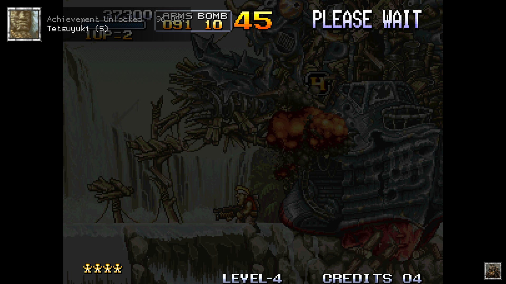

# PS5_RetroArch-v4.4.0-beta-4

**Achievements pop on screen. Your login stays.**

## PS5 RetroArch is a passion project, not a piracy project.

It exists so you can play the games you own on the console you own.

- **Piracy is not condoned.**
- **No games, BIOS files, console firmware or decryption keys are included, and they never will be.**
- **Use only legally obtained backups of games you own**, made yourself from your own discs, cartridges or digital purchases.
- **Use only BIOS and firmware files dumped from hardware you own.**
- **Requests for, or links to, games, BIOS files, firmware or keys are not welcome** in this project's issues or discussions.

---

##  Thank you

| Contributor | What they brought |
| --- | --- |
|  **Diego** [@dirrini](https://github.com/dirrini) | **Notification widgets** ([#122](https://github.com/mihawk-99/PS5_RetroArch/pull/122)): RetroArch's graphical notifications, with the fonts and icons they need and their licences. Reviewed, tested, and played on a Base PS5 before it was taken. |

Thank you also to **rafaelbodri** for reporting the lost RetroAchievements login ([#110](https://github.com/mihawk-99/PS5_RetroArch/issues/110)) and **victorrentvd** for the missing Naomi list ([#109](https://github.com/mihawk-99/PS5_RetroArch/issues/109)).

##  At a glance

| What's new | What it means |
| --- | --- |
|  **Notification widgets** | Achievements, progress and RetroArch's own messages appear as graphical notifications instead of yellow text. |
|  **RetroAchievements login** | You stay signed in after closing RetroArch from the PS5 home screen. |
|  **Naomi 2** | Naomi 2 is its own system, so it no longer takes over the Naomi list. |

##  Notification widgets

- **Achievements you can see.** An unlocked achievement shows its badge, name and points. A game's achievement count shows when it starts, and progress trackers sit in the corner of the screen while you play.
- **RetroArch's messages too.** Sign-in, controller and other notices are drawn the same way.
- **On by default, also after an update.** Older builds saved this setting as off, because they had no widgets. This release turns it on once when you update; after that the choice is yours.
- **To turn them off:** Settings → On-Screen Display → On-Screen Notifications → Graphics Widgets.

##  RetroAchievements login

- **You stay signed in.** RetroArch was asking for the RetroAchievements password again after it had been closed from the PS5 home screen. It forgot the saved password as soon as it signed in, but kept its sign-in token only in memory, and a title the console closes never saves its settings.
- **The fix:** the account is now saved at the moment you sign in, and the password is forgotten only after that.

##  Naomi 2

- **Naomi and Naomi 2 are separate systems.** A Naomi 2 playlist or folder was folded into Naomi, which made the Naomi list disappear in EmulationStation. Each now has its own list, in the WebUI too.

##  Played on a Base PS5

| What | How it went |
| --- | --- |
| **Notification widgets** | The menu draws as before. Notifications appeared as widgets over a software-rendered core and a hardware-rendered one, with no crash. |
| **Achievements** | With a real account: the game's achievement count, the progress trackers and an unlocked achievement all showed as widgets, and the achievement was awarded. |
| **RetroAchievements login** | Signed in with the password, closed RetroArch from outside, started it again: it signed in with its saved token. On v4.3.0-beta-4 the same steps ended in "password is required". |
| **Widgets after an update** | With the setting saved as off by an older build, this release started with it on, and left a later choice of off alone. |
| **Naomi 2** | Covered by a test: a Naomi list and a Naomi 2 list stay two systems. |

##  Upgrading from v4.3.0-beta-4

1. **Back up your existing title folder**, especially configuration, saves, states, system files, content and any custom media.
2. **Use the WebUI's Update button**, or merge the complete `PPSA99169` folder from the package into your installation, keeping your own files and configuration.
3. Fully close and reopen PS5 RetroArch. If RetroAchievements asks you to sign in, do it once more: from then on it stays signed in.

**No games, BIOS files, console firmware, or decryption keys are supplied. Use only legally obtained backups of games you own and system files dumped from hardware you own.**

##  Source, licences, and credits

Changes since **v4.3.0-beta-4**. [Release source](https://github.com/mihawk-99/PS5_RetroArch/tree/v4.4.0-beta-4); component source links and exact revisions are included in `licenses/components.json`. The widget fonts and icons are unmodified files from libretro's retroarch-assets, with the Inter and M+ font licences in `licenses/`. RADV is built from [PS5_Mesa](https://github.com/mihawk-99/PS5_Mesa) and [PS5_Vulkan](https://github.com/mihawk-99/PS5_Vulkan) at the revisions this repository pins, with the payload SDK at its pinned revision. The SDK's elevation client is rebuilt with `platform/sdk/elevation-root-proof.patch`, and Beetle PC-FX with `patches/beetle-pcfx/missing-disc.patch`, both from this repository.

Snes9x, FinalBurn Neo, Genesis Plus GX, PicoDrive, Opera, and the Alekfull NX theme carry non-commercial restrictions. **This distribution may not be sold, and this release carries no donation link.** The package's `licenses/` directory records component licences and exact source revisions. RPCS3 is not included.

Thank you to the RetroArch/libretro community, the emulator and ES-DE developers, and the PS5 homebrew scene. Icons: Microsoft Fluent UI System Icons (MIT).

---

**Ready to get started?** [Available releases](https://github.com/mihawk-99/PS5_RetroArch/releases) · [Installation guide](https://github.com/mihawk-99/PS5_RetroArch#get-started) · [Source and credits](#credits)
