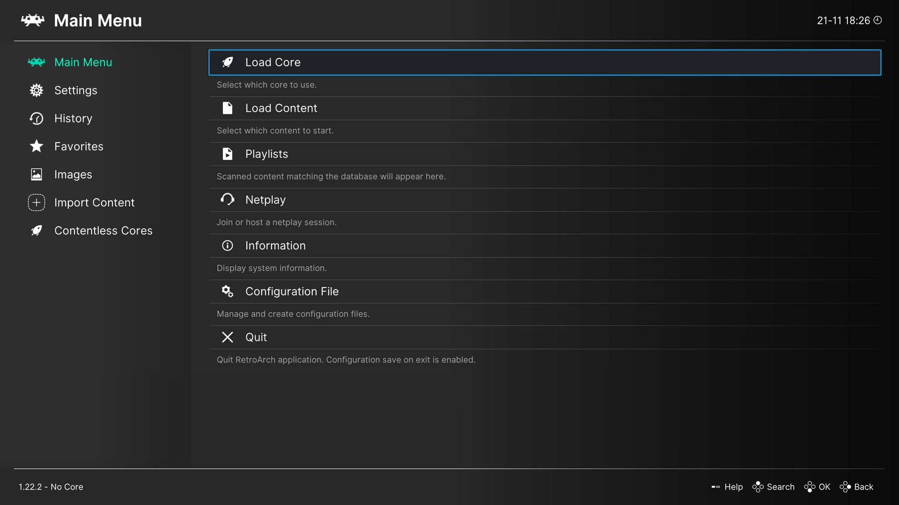

# PS5_RetroArch-v4.6.0-beta-4

**The Ozone menu is here, and the Update button works.**

## PS5 RetroArch is a passion project, not a piracy project.

It exists so you can play the games you own on the console you own.

- **Piracy is not condoned.**
- **No games, BIOS files, console firmware or decryption keys are included, and they never will be.**
- **Use only legally obtained backups of games you own**, made yourself from your own discs, cartridges or digital purchases.
- **Use only BIOS and firmware files dumped from hardware you own.**
- **Requests for, or links to, games, BIOS files, firmware or keys are not welcome** in this project's issues or discussions.

---

##  Thank you

Thank you to **darkxex**, **asp0909** and **ElMeteK** for asking for Ozone ([#91](https://github.com/mihawk-99/PS5_RetroArch/issues/91), [#67](https://github.com/mihawk-99/PS5_RetroArch/issues/67)), and to **asp0909**, **Eli0rZeR70** and **AnAngryParsnip** for reporting the update that never installed ([#75](https://github.com/mihawk-99/PS5_RetroArch/issues/75)).

##  At a glance

| What's new | What it means |
| --- | --- |
|  **The Ozone menu** | A third menu for RetroArch, beside XMB and RGUI: a sidebar, a list, eleven colour themes. |
|  **The Update button works** | From this release on, the WebUI downloads, verifies and installs a new release by itself. |

##  The Ozone menu

- **A third menu.** RetroArch's Ozone menu is built in, with its sidebar, its icons and its eleven colour themes. XMB stays the default: nothing changes unless you choose Ozone.
- **To choose it on the console:** Settings → Drivers → Menu, then restart RetroArch.
- **To choose it from the WebUI:** Settings → Interface → **Console menu style**.
- **The WebUI's QR code is shown in XMB and RGUI only.** Ozone has no WebUI entry yet. The WebUI itself runs whichever menu you use, at the same address.

##  The Update button works

- **What was wrong.** The WebUI downloaded a new release and then nothing happened: the page offered the same update again. Three faults were behind it, and each one alone was enough.
- **The update stopped as it began to verify the download.** The WebUI's background service crashed at that moment, restarted, and had forgotten the update.
- **Every release was refused as invalid.** A package carries an empty content folder for each system, and the updater did not accept folders.
- **An update would have left EmulationStation, the picker, the Game Forwarder and the Lapy service at their old versions.** They are installed with everything else now.
- **One more manual update.** The faults are inside every earlier release, v4.5.0-beta-4 included, so their Update button cannot install this one. Install this release by hand once; from then on the button works.

##  Played on a Base PS5

| What | How it went |
| --- | --- |
| **Ozone** | The menu drew at 4K with its sidebar, icons and cursor. It was walked with the controller through the main menu, a submenu and the sidebar, and its Quick Menu opened over a running game. No crash. |
| **The update, before** | With v4.4.0-beta-4 installed, the download finished and the WebUI's service restarted the same minute; the update was back at the start. |
| **The update, after** | A build with the fixes downloaded v4.5.0-beta-4, checked its 19,482 entries in four minutes, closed RetroArch, installed in five seconds, and started again as that release, with matching files. |

##  Upgrading from v4.5.0-beta-4

1. **Back up your existing title folder**, especially configuration, saves, states, system files, content and any custom media.
2. **Merge the complete `PPSA99169` folder from the package into your installation**, keeping your own files and configuration. The Update button of v4.5.0-beta-4 and earlier cannot install this release.
3. Fully close and reopen PS5 RetroArch. Later releases can be installed with the WebUI's Update button.

**No games, BIOS files, console firmware, or decryption keys are supplied. Use only legally obtained backups of games you own and system files dumped from hardware you own.**

##  Source, licences, and credits

Changes since **v4.5.0-beta-4**. [Release source](https://github.com/mihawk-99/PS5_RetroArch/tree/v4.6.0-beta-4); component source links and exact revisions are included in `licenses/components.json`. The Ozone menu's images are unmodified files from libretro's retroarch-assets (CC-BY-4.0), each listed with its digest in `assets/ozone/source.json`. RADV is built from [PS5_Mesa](https://github.com/mihawk-99/PS5_Mesa) and [PS5_Vulkan](https://github.com/mihawk-99/PS5_Vulkan) at the revisions this repository pins, with the payload SDK at its pinned revision. The SDK's elevation client is rebuilt with `platform/sdk/elevation-root-proof.patch`, and Beetle PC-FX with `patches/beetle-pcfx/missing-disc.patch`, both from this repository.

Snes9x, FinalBurn Neo, Genesis Plus GX, PicoDrive, Opera, and the Alekfull NX theme carry non-commercial restrictions. **This distribution may not be sold, and this release carries no donation link.** The package's `licenses/` directory records component licences and exact source revisions. RPCS3 is not included.

Thank you to the RetroArch/libretro community, the emulator and ES-DE developers, and the PS5 homebrew scene. Icons: Microsoft Fluent UI System Icons (MIT).

---

**Ready to get started?** [Available releases](https://github.com/mihawk-99/PS5_RetroArch/releases) · [Installation guide](https://github.com/mihawk-99/PS5_RetroArch#get-started) · [Source and credits](#credits)
